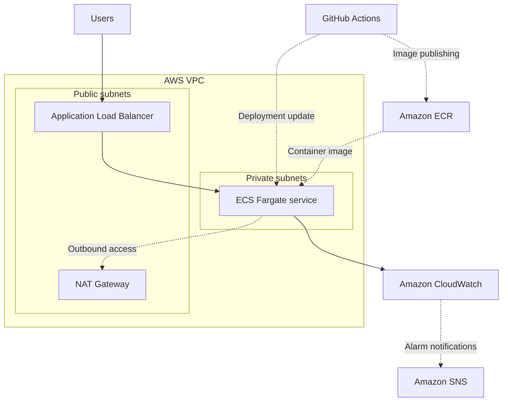

# EduTech LMS on AWS ECS Fargate — Terraform & CI/CD

A hands-on AWS Cloud/DevOps engineering project built around a containerized Learning Management System (LMS) frontend. What began as a basic ECS Fargate deployment evolved into an infrastructure-refactoring exercise focused on **network isolation, modular Terraform, deployment safety, observability, and repeatable delivery**.

> **Project scope:** This repository demonstrates infrastructure and deployment practices for an LMS *frontend*. It is not presented as a complete production LMS or as an audited production environment. AWS resources may be destroyed between lab sessions to control costs.

## Why I built this

My first implementation answered a basic question: *Can I containerize an application and serve it through an AWS Application Load Balancer on ECS Fargate?*

After getting that deployment working and practicing ECS troubleshooting, I revisited the design with a more operational question: *How would I structure and operate this workload more safely and predictably?*

The refactor explores the difference between an application that runs and infrastructure that is easier to deploy, troubleshoot, maintain, and recover.

## Architecture

The refactored design separates the public entry point from application workloads:



**Design principles**

- Keep the internet-facing load balancer in public subnets while placing application tasks in private subnets.
- Use narrowly scoped security-group rules between the ALB and ECS tasks.
- Use NAT for outbound connectivity from private subnets when needed; NAT is **not** the inbound access path.
- Define infrastructure through reusable Terraform modules instead of one large configuration.
- Route application logs and operational signals to CloudWatch.
- Build deployment checks into CI/CD instead of treating a successful image push as proof of application health.

> The diagram summarizes the intended refactored architecture. Inspect the Terraform configuration for the deployed settings of each environment.

## Technology stack

| Area | Technologies |
| --- | --- |
| Compute | Amazon ECS, AWS Fargate |
| Containers | Docker, Amazon ECR |
| Networking | Amazon VPC, public/private subnets, route tables, NAT Gateway, security groups, Application Load Balancer |
| Infrastructure as Code | Terraform |
| CI/CD | GitHub Actions |
| Observability | Amazon CloudWatch; Amazon SNS for alert delivery where configured |
| Access management | AWS IAM |

## Repository layout

```text
.
├── .github/workflows/       # GitHub Actions workflows
├── app/                     # Containerized LMS frontend
├── bootstrap/               # Infrastructure bootstrap configuration
├── environments/            # Environment-specific Terraform configuration
├── modules/                 # Reusable Terraform building blocks
├── .gitignore
├── README.md
└── terraform.tfvars.example
```

Separating `bootstrap/`, `environments/`, and `modules/` makes infrastructure responsibilities clearer and supports more controlled changes. The exact module interfaces and environment names are defined in the source files.

## What changed during the refactor

| Area | Refactoring focus |
| --- | --- |
| Terraform organization | Separate reusable infrastructure modules from environment configuration |
| Network architecture | Move ECS workloads behind the ALB into private subnets; provide outbound routing through NAT |
| Availability | Configure desired ECS task count and load-balancer health checks |
| Deployment safety | Use ECS deployment health checks and rollback-oriented controls |
| Observability | Add CloudWatch visibility and alarms for operational signals |
| Automation | Automate container delivery and ECS deployment through GitHub Actions |
| Verification | Add an HTTP smoke-test step to the deployment pipeline |

These are the engineering areas addressed by the refactoring work. **Do not treat this table as proof that every failure mode was tested.** The workflow history, ECS service events, and Terraform source are the evidence for individual validations.

## Delivery and verification

The GitHub Actions deployment workflow includes an **HTTP smoke test** (introduced in commit [`041b5eb`](https://github.com/artemsaitov/edutech-lms-ecs-fargate-terraform/commit/041b5eb)). This checks application reachability after deployment, rather than relying solely on whether the pipeline executed successfully.

For an ECS release, useful verification points include:

1. The container image is available in Amazon ECR.
2. The updated ECS service reaches a stable running state.
3. The ALB target group reports healthy targets.
4. The application's HTTP endpoint responds as expected.
5. CloudWatch logs and ECS events show no unresolved deployment issues.

Not all of these checks necessarily run as automated gates; inspect `.github/workflows/` for the checks that are currently enforced.

## Working with the Terraform configuration

**Prerequisites:** an AWS account, AWS CLI authentication, Terraform, Docker, and permissions appropriate to the resources being deployed.

Start by reviewing `terraform.tfvars.example`, the environment configuration under `environments/`, and any backend/bootstrap settings under `bootstrap/`.

From the relevant Terraform root module (the directory containing the configuration for the environment you intend to deploy):

```bash
terraform fmt -check -recursive
terraform init
terraform validate
terraform plan
```

Review the plan carefully before any `terraform apply`. Confirm the AWS account, region, remote-state backend, variables, image configuration, and cost implications. Depending on the environment and workflow, the image may need to be built and pushed to ECR before the service can start.

**Important:** Terraform commands above are general validation steps, not a verified one-command deployment recipe for this repository. Follow the actual configuration and workflow inputs when applying infrastructure.

## Operations and troubleshooting

This project also includes hands-on troubleshooting work with common ECS/ALB failure modes, such as:

- `CannotPullContainerError` when an image is absent from ECR.
- Unhealthy ALB targets caused by health-check or networking misconfiguration.
- ECS tasks that fail to reach a steady state.
- Missing or insufficient CloudWatch logs during investigation.

A practical investigation path is **ECS service events → stopped-task reason → ALB target health → security groups and routes → CloudWatch logs**. The purpose is to identify the failing layer before changing infrastructure.

Related write-up: [Troubleshooting ECS Fargate: From Symptoms to Root Cause](https://medium.com/@art.saitov/troubleshooting-ecs-fargate-from-symptoms-to-root-cause-fcbafe08d14b).

## Costs and cleanup

This is a learning/portfolio environment, **not a continuously hosted public service**. AWS resources may incur charges while provisioned, including NAT Gateway hourly/data-processing charges, ALB usage, Fargate tasks, logging, and other resources. Check pricing for your region and review your Terraform plan before applying changes.

When a lab is finished, destroy resources **from the same Terraform root and state used to create them**, after verifying the target account and plan. Review persistent items separately (for example, ECR images, state storage, and log retention), and confirm teardown in the AWS console and billing tools.

## Engineering takeaways

- A successful deployment is the starting point, not the end of operating a workload.
- Private tasks, ALB routing, and egress requirements need to be designed together.
- Terraform module boundaries can simplify review, reuse, and changes over time.
- CI/CD should verify application behavior, not just push an image or update a service.
- ECS events, target health, and CloudWatch signals are complementary troubleshooting tools.
- Cost management and safe teardown are part of real cloud engineering work.

## Author

**Artem Saitov** — AWS Cloud / DevOps Engineer

[GitHub](https://github.com/artemsaitov) · [Medium](https://medium.com/@art.saitov)
